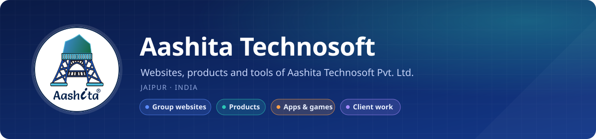
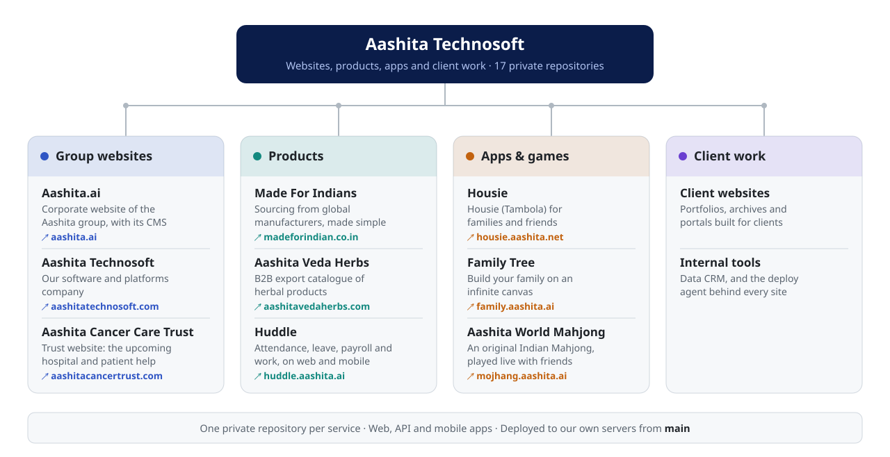

  

  <a href="https://aashitatechnosoft.com"><b>aashitatechnosoft.com</b></a> &nbsp;·&nbsp;
  <a href="https://aashita.ai"><b>aashita.ai</b></a> &nbsp;·&nbsp;
  <a href="mailto:aashitatechnosoft@gmail.com"><b>aashitatechnosoft@gmail.com</b></a>

**Aashita Technosoft Pvt. Ltd.** is the software company of the Aashita group in Jaipur, India. This account holds our websites, products, apps, internal tools and client work. Our production platforms (trade intelligence, EdTech, ListUrAd and Spark) live at **[@AashitaProd](https://github.com/AashitaProd)**. The repositories are private.

## What we build

<picture>
  <source media="(prefers-color-scheme: dark)" srcset="assets/platforms-dark.svg">
  
</picture>

  <b>Live:</b> &nbsp;
  <a href="https://aashita.ai">aashita.ai</a> &nbsp;·&nbsp;
  <a href="https://aashitatechnosoft.com">aashitatechnosoft.com</a> &nbsp;·&nbsp;
  <a href="https://aashitacancertrust.com">aashitacancertrust.com</a> &nbsp;·&nbsp;
  <a href="https://madeforindian.co.in">madeforindian.co.in</a> &nbsp;·&nbsp;
  <a href="https://aashitavedaherbs.com">aashitavedaherbs.com</a> &nbsp;·&nbsp;
  <a href="https://housie.aashita.net">housie.aashita.net</a> &nbsp;·&nbsp;
  <a href="https://family.aashita.ai">family.aashita.ai</a> &nbsp;·&nbsp;
  <a href="https://mojhang.aashita.ai">mojhang.aashita.ai</a>

## Built with

  

## Working here

- Each project has its own private repository, and `main` is what runs live.
- A push to `main` deploys automatically, so `main` must always be ready to ship.
- Servers pull with read-only deploy keys, and secrets never go into git.

© Aashita Technosoft Pvt. Ltd. · Jaipur, India. The logos in the stack image are trademarks of their owners.
